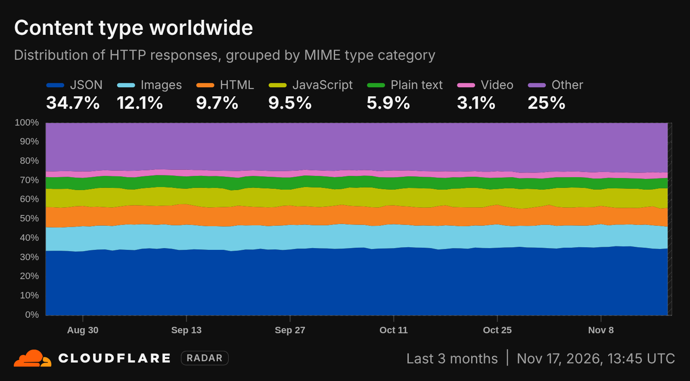
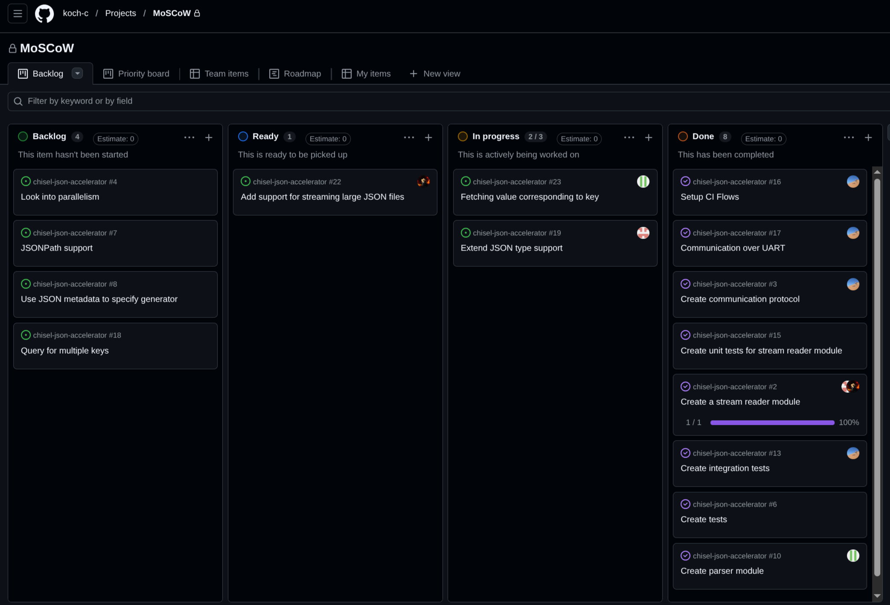

# JAW - JSON Accelerator in Wires
This repo contains the Chisel code for a hardware-accelerated JSON parser that accepts [`JSONPath`](https://goessner.net/articles/JsonPath/) queries.

## Motivation

We wanted to create a hardware generator that could solve a problem we could all relate to. After a little bit of thinking we agreed to work on creating an accelerator that could parse JSON, since we had all worked with JSON many times before. While it might sound a bit boring to create an accelerated parser, it is nevertheless something that has a real use case. 

For example, on [Cloudflare Radar](https://radar.cloudflare.com/traffic) we can see that JSON constitutes a large share of HTTP responses on Cloudflare's servers worldwide. On the 17th of November, 2026, JSON constituted `34.7%` of all HTTP responses over the past 3 months. JSON far surpasses any other kind of MIME type in HTTP responses. 
[](https://radar.cloudflare.com/traffic)

Google have also investigated what operations large datacenters spend a lot of resources. In the paper [*Profiling a Warehouse-Scale Computer*](https://ieeexplore.ieee.org/document/7478434/) (Kanev et al., IEEE Micro 2016) found that **22–27% of CPU cycles** in Google's fleet were spent on infrastructure operations, including protocol-buffer management. The authors of the paper identify serialization and deserialization as promising hardware-acceleration targets.

## Design

Our design is based on the architecture introduced in [*SPEAR-JSON*](https://ieeexplore.ieee.org/document/10296352) (Hahn et al., FPL 2023). We chose to follow the design of the paper for a number of reasons:
- **It is a hardware generator**. This design is meant to support queries that run for a long period of time. Instead of accepting arbitrary `JSONPath` queries, the design takes the query as a parameter and generates dedicated HDL tailored to the query. 
- **It is minimal**. It strives to create an efficient and small implementation that does not use a lot of FPGA resources.
- **It is a part in a larger machinery**. The implementation is meant to be used in a larger data pipeline that enables the implementation to ingest, parse, and return results. In our design we connect the design to our computer using UART. 

The paper introduces a design that utilizes the sparsity of JSON to increase parsing throughput. Essentially it uses a `path encoder` to find relevant symbols in the JSON file, after which a `pushdown automata` matches the symbols with whatever `JSONPath` query the `FPGA` has been synthesized to parse. Consider the example below where the `JSONPath` query is: `$.(id|user.name)`


Figure 1 from the [*SPEAR-JSON*](https://ieeexplore.ieee.org/document/10296352) paper.

Instead of considering every character of the JSON equally, we use the `path encoder` to first find all the symbols of the JSON (the small gray boxes below the JSON string). Symbols are essentially just structural characters of JSON like `,`, `}`, `:`, etc. and keys in a JSON. These symbols are fed to the `pushdown automata`, and the automata compare them one at a time with the prefix of the query the FPGA has been synthesized to match. Every time there is a match between a symbol and a prefix in the query, the `pushdown automata` pushes the prefix to its stack. In this way the `pushdown automata` can keep track of how much of a query has been matched on some path.  

## Architecture

`Accelerator` is the core of JAW. It takes in JSON bytes and sends back binary records. We put UART in `AcceleratorTop`, a wrapper around the core, so `Accelerator` doesn't depend on how the bytes get to it. This also lets us test the core directly without simulating UART.

The core has three sections, shown in the diagram below:

- `extract` finds the requested fields and fetches their bytes from the input buffer.
- `parser` turns those bytes into typed integer and string values.
- `output` assembles the values in configuration order, applies the filters, and serializes the response.

```mermaid
---
config:
  layout: elk
  theme: base
  themeVariables:
    lineColor: '#64748b'
    textColor: '#0f172a'
    edgeLabelBackground: '#f8fafc'
  elk:
    mergeEdges: true
---
flowchart LR
    RX[UartRx]

    subgraph CORE[Accelerator]
        subgraph EXTRACT[extract]
            INPUT[InputFIFO] -->|8-byte words| LEXER[Parallel Lexer]
            INPUT -->|8-byte words| BUFFER[(InputBuffer)]
            LEXER --> FIFO[ChannelFifo] --> PDA[PushdownAutomaton]
            PDA -->|Descriptors| LOADER[AttributeLoader]
            BUFFER -->|Stored words| LOADER
        end

        subgraph PARSE[parser]
            UNPACK[Per-channel queue and WordUnpacker]
            UNPACK --> NUM[NumberParser]
            UNPACK --> STR[StringParser]
        end

        subgraph OUTPUT[output]
            REORDER[Reorder Queue] --> ASSEMBLER[RecordAssembler]
            ASSEMBLER --> FILTER[RecordFilter]
            ASSEMBLER -->|Complete record| SERIALIZER[RecordSerializer]
            FILTER -->|Keep or reject| SERIALIZER
        end

        LOADER -->|Value chunks by channel| UNPACK
        LOADER -->|Result order and end marker| REORDER
        NUM --> ASSEMBLER
        STR --> ASSEMBLER
    end

    RX --> INPUT
    SERIALIZER -->|Outcome byte and optional record| TX[UartTx]

    style CORE fill:#e2e8f0,stroke:#475569,stroke-width:2px,color:#0f172a
    style EXTRACT fill:#eff6ff,stroke:#3b82f6,color:#172554
    style PARSE fill:#f5f3ff,stroke:#8b5cf6,color:#2e1065
    style OUTPUT fill:#ecfdf5,stroke:#10b981,color:#022c22

    classDef extractNode fill:#dbeafe,stroke:#2563eb,color:#172554
    classDef memoryNode fill:#bfdbfe,stroke:#1d4ed8,color:#172554
    classDef parserNode fill:#ede9fe,stroke:#7c3aed,color:#2e1065
    classDef outputNode fill:#d1fae5,stroke:#059669,color:#022c22
    classDef uartNode fill:#334155,stroke:#64748b,color:#ffffff

    class INPUT,LEXER,FIFO,PDA,LOADER extractNode
    class BUFFER memoryNode
    class UNPACK,NUM,STR parserNode
    class REORDER,ASSEMBLER,FILTER,SERIALIZER outputNode
    class RX,TX uartNode
```



- `UartRx` receives the JSON bytes from our computer over UART and passes them to the `InputFIFO`.
- `InputFIFO` packs the incoming bytes into 8-byte words, adapting the byte-by-byte UART input to the wider input of the `Lexer`. The same words are also written to the `InputBuffer`, so we can retrieve the original values later.
- `Lexer` examines all eight bytes of a word in parallel and can accept one word per cycle when unstalled. It carries string and escape state across word boundaries, then emits structural characters and recognized keys as symbols with their byte positions. Each output batch contains up to eight symbols in input order; words with no symbols produce no batch.
- `ChannelFifo` buffers symbols, accepting batches of up to eight from the `Lexer` and delivering up to two symbols per cycle to the `PushdownAutomaton`. This absorbs bursts of symbols so the lexer only has to stall when the FIFO is full.
- `PushdownAutomaton` uses a stack to keep track of the current path through the JSON and compares it with the query the FPGA has been synthesized to match. When it finds a matching value, it sends the value's location to the `AttributeLoader`.
- `InputBuffer` stores the original JSON bytes while the symbols move through the parser. The `AttributeLoader` reads from this buffer to retrieve a matching value without having to reconstruct it from symbols.
- `AttributeLoader` uses the location from the `PushdownAutomaton` to read the matching value from the `InputBuffer`. It then passes the original value bytes to `UartTx`.
- `UartTx` sends the extracted value bytes back to our computer over UART, completing the flow.
<!-- TODO: Document the NumberParser and NumberSerializer output path. -->

### Parameterization
Our hardware generator takes a `JsonPathConfig`. This is where we tell JAW which fields to extract, how to represent them, and which records to keep. The configuration is compiled into the generated hardware. JAW supports paths made up of object keys: for example, we write `$.user.name` as `Seq("user", "name")`.

| Parameter | Explanation |
|---|---|
| `fields` | The 1 to 256 fields we want to extract, in output order. Each `FieldSpec` has a path and a type: `Int32` (the default), `Int64`, or `String`. For strings, `stringBytes` sets the capacity in bytes (default: 32). |
| `maxDepth` | The maximum object-key path depth (default: 8). |
| `filters` | Optional predicates on fields we extract. A record is kept only if all predicates pass. Integers support `==`, `<`, `<=`, `>`, and `>=`, while strings support exact equality. A missing or invalid field fails any predicate that uses it. |
| `numericParsers`, `stringParsers` | How many parsers of each kind can work in parallel (default: one each). We only generate parsers for the kinds of fields we extract. |

For example, suppose we want to extract `id` and `user.name`, and only keep records whose `id` is exactly `42`. We configure JAW like this:

```scala
val config = JsonPathConfig(
  fields = Seq(
    FieldSpec(Seq("id"), ValueType.Int64),
    FieldSpec(Seq("user", "name"), ValueType.String, stringBytes = 32)
  ),
  filters = Seq(
    FilterSpec(Seq("id"), CompareOp.Eq, IntLit(BigInt(42)))
  )
)
```

JAW returns binary bytes, not JSON or text. We read the first byte to find out what comes next: `00` means the record was rejected and the response is finished. `01` means the record was kept and the fixed-size record follows.

For example, if we send `{"user":{"name":"Ada"},"id":42}` followed by a newline, JAW sends the following bytes. The `|` marks separate parts of the response; they are not sent over UART.

```text
01 | 05 | 2a 00 00 00 00 00 00 00 | 03 00 41 64 61 [29 zero bytes]
```

- **`01` - kept.** The `id == 42` filter passed.
- **`05` - field status.** Each field gets two bits, and `01` means the field is valid. `id` uses the lowest two bits and `user.name` uses the next two. With both fields valid, we get `0000 0101`, or `05` in hex.
- **`2a 00 00 00 00 00 00 00` - ID.** `2a` is 42 in hex. The ID takes eight bytes, and we send the least significant byte first (little-endian).
- **`03 00 41 64 61` followed by 29 zero bytes - name.** `03 00` is the two-byte little-endian length of the string actually found. The next three bytes spell `Ada`. We fill the rest of the 32-byte string capacity with zeros.

We get `id` before `user.name` because JAW sends the fields in configuration order, not in the order they appear in the JSON. Every kept response for this configuration is **44 bytes**: 1 outcome byte + 1 status byte + 8 ID bytes + 2 length bytes + 32 string bytes. There is no trailing newline. If we change the input to `"id":43`, JAW sends just `00`, because `id` does not pass the specified filter.

## Agile Development
We of courses implemented JAW with an Agile mindset. Every Thursday after class we had our weekly standups, where we talked about what tickets we had completed, what was blocking us, and we decided what we wanted to work on for the next spring. We organized ourselves through GitHub Projects in a kanban board



### CI
We used GitHub Actions to facilitate continuous integration. We started with a simple action that ran all chisel tests:
```yaml
jobs:
  test:
    # Shortened
      - name: Run tests
        run: sbt test
```
But we later extended CI to also apply formatting checks and ensuring that the chisel code could compile to SystemVerilog:
```yaml
jobs:
  test:
    # Shortened
      - name: Check Scala formatting
        run: sbt "scalafmtCheckAll; scalafmtSbtCheck"

      - name: Run tests
        run: sbt test

      - name: Generate top-level Verilog
        run: |
          sbt "runMain GenerateAcceleratorTop"
          test -s generated/AcceleratorTop.sv
```

To make it easier for us to have consistent code formatting, we also created a Git pre-commit hook, that runs `sbt scalafmtOnly` on the files that are being committed. Because git does not auto enable pre-commit hooks, one must enable it manually after clone using: `git config --local core.hooksPath .githooks`.

### Initial Design Process

We adopted the mindset, **build, deploy, repeat** and in the beginning of the project we pushed for an MVP. Our first MVP was very simple. It essentially streamed a simple JSON string stored on chip, and lid an LED depending on whether or not the JSON contained the key matching a basic `JSONPath` query. It accepted JSON strings like
```json
{ "temperature": 25, "humidity": 60 }
```
We very quickly designed, synthesized, implemented and ran the first MVP on the FPGA board. When we had accomplished the first *M*VP we moved on to a MVP 2. This MVP had UART support, so we could stream arbitrarily large JSON files to the FPGA board, and the board would reply back with value matching the configured `JSONPath` query. We also extended our support for more complex `JSONPath` queries such that we could also detect keys in nested objects like:

```json
{"system":{"board":"Nexys 4 DDR","location":"lab bench","firmware":{"version":"1.2.3","build":20261027},"sensors":[{"name":"humidity","value":60},{"name":"pressure","value":1013},{"temperature":"twenty-five degrees"}],"notes":"UART streaming JSON test with nested objects, an array, and a sufficiently long message to cross many eight-byte blocks"},"enabled":true}     
```

Once we had completed the MVP 2 and made it run on the FPGA board, we processed to implement the final version of JAW. 
<!-- TODO: describe how we first designed the first part followed by the two parsers and filtering logic -->

# AI and LLM Usage
We used LLM and coding harnesses to assist us in the development of JAW. We primarily focus on the architecture of JAW and created implementation plans. We then made agents create an implementation of our architecture plan, and we iterated over the generated code many times together with the agent, so the end result was efficient and was an implementation of what we required. When the agent was incapable of delivering, we implemented parts of the chisel code ourselves. We adopted this approach to try and learn the future of chip design, where agents increasingly will write the code for us, and the chip designers must be critic and validate the generated code.
