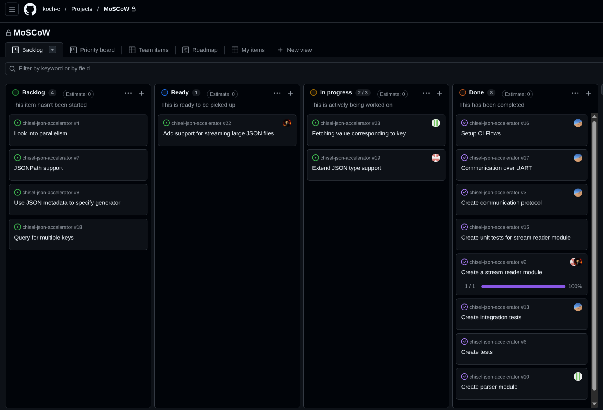

# Chisel JSON Accelerator
## What we are building & MVP 1

<div class="columns">
<div>

- Hardware-accelerated JSON parser
- Processes JSON as a stream and searches for a selected key in hardware.
- **MVP 1:** detect `temperature` in a simple JSON object and light an LED.

</div>
<div class="example">

```json
{ "temperature": 25, "humidity": 60 }
```

</div>
</div>

---

# MVP 2 — More realistic JSON processing

<div class="mvp2">
<div>

- Send (large) JSON documents to the FPGA over **UART**.
- Support nested objects and arrays.
- Return the matching value plus `FOUND`; otherwise return `NOT_FOUND`.

</div>
<div class="example">

```json
{
  "system": {
    "board": "Nexys 4 DDR", "location": "lab bench",
    "firmware": { "version": "1.2.3", "build": 20261027 },
    "sensors": [
      { "name": "humidity", "value": 60 },
      { "name": "pressure", "value": 1013 },
      { "temperature": "twenty-five degrees" }
    ],
    "notes": "UART streaming JSON test"
  },
  "enabled": true
}
```

</div>
</div>

---

# Agile workflow

<div class="columns">
<div class="kanban">



</div>
<div>

- **Visualize work:** Backlog → Ready → In progress → Done.
- **Limit work in progress:** focus on a small number of active tasks.
- **Sprints:** we meet every tuesday and figure out what we done the last sprint and what to do the next sprint.

</div>
</div>
